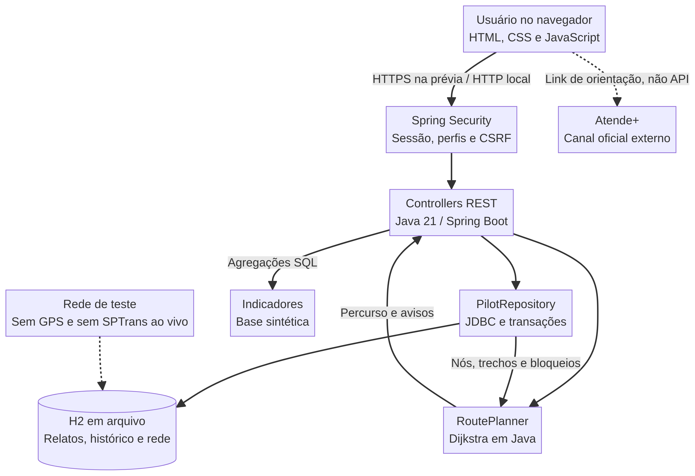
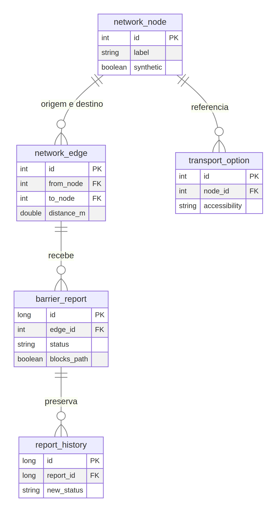
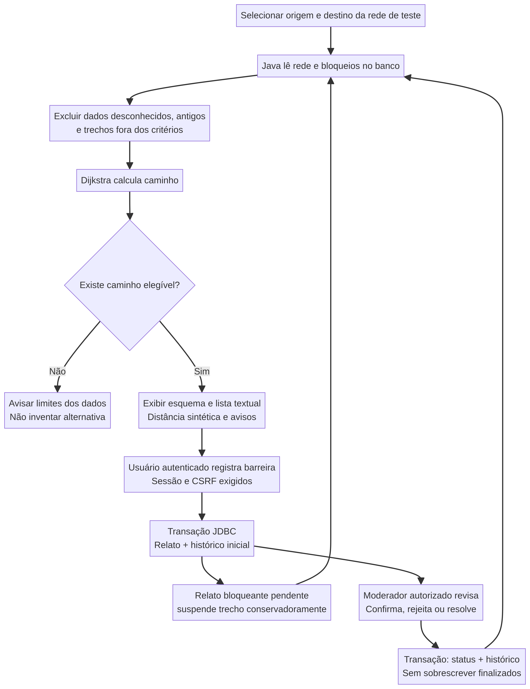

# Rota Livre
## Mobilidade com menos barreiras — piloto CitizenTech

**Juliano de Oliveira Falcão — RM 565907**  
**Versão:** 0.1.0 · **Data:** 07/11/2026 · **Referência:** Santo Amaro, Zona Sul de São Paulo

**Documento do protótipo inicial.** A implementação técnica foi testada; não houve entrevista com o público-alvo, vistoria de ruas, validação clínica, certificação de acessibilidade ou publicação permanente. Esta etapa não encerra a entrega acadêmica.

# 1. Problema e proposta

Uma pessoa que utiliza cadeira de rodas não precisa apenas saber a distância até um destino. Um degrau, uma obra ou um ponto de passagem estreito pode interromper o caminho. Descobrir a barreira somente durante o deslocamento prejudica a autonomia e a previsibilidade da viagem. Essa é a hipótese de problema do Rota Livre; sua relevância específica e as preferências do público devem ser confirmadas com pessoas afetadas.

O projeto propõe reunir informação sobre trechos, barreiras e conexões de transporte, mantendo origem, data e limites do dado visíveis. Sua diferença não é oferecer qualquer rota de pedestres com o rótulo de “acessível”, mas excluir conservadoramente aquilo que não atende aos critérios ou não tem informação suficiente.

O público prioritário são pessoas que utilizam cadeira de rodas e, secundariamente, acompanhantes. O piloto toma como referência o entorno do Terminal Santo Amaro, cujo endereço oficial é Avenida Padre José Maria, 400 [1]. Não foram delimitados nem vistoriados quarteirões reais: a implementação inicial usa **12 pontos e 20 ligações sintéticas**, representados num esquema sem coordenadas GPS. A cobertura territorial real de quatro a seis quarteirões continua como objetivo de uma etapa de levantamento.

## 1.1 Storytelling — situação ilustrativa

Uma usuária precisa chegar a um serviço de saúde. No demonstrador, escolhe o ponto de partida e o destino. O sistema encontra um percurso na rede de teste. Outro colaborador registra uma obra que impede uma das ligações. A rota é recalculada sem aquele trecho, e o desvio fica explícito. Se não houver alternativa, o sistema comunica o limite dos dados em vez de garantir um caminho inexistente. Essa narrativa é ilustrativa: não é depoimento, viagem ou benefício medido de uma pessoa real.

## 1.2 Relação com os ODS

O **ODS 11, meta 11.2**, relaciona-se ao acesso a transporte com atenção às necessidades de pessoas com deficiência [4]. O Rota Livre pretende apoiar informação para deslocamento e conexão com transporte; não realiza obras nem mede o indicador oficial da ONU. O **ODS 10, meta 10.2**, relaciona-se à inclusão e participação social [5]: a proposta busca reduzir barreiras de informação e apoiar autonomia. O impacto permanece uma hipótese até avaliação com o público e dados reais.

# 2. Solução implementada

O Spring Boot serve a interface HTML/CSS/JavaScript e uma API REST. As regras, consultas e gravações ficam em **Java 21**. O navegador não simula persistência por localStorage e não executa o algoritmo de rota. O **JDBC** acessa um **H2 em arquivo**, que preserva relatos e histórico após reiniciar o processo. Spring Security protege escrita, moderação e CSRF.

| Componente | Justificativa e função |
| --- | --- |
| Java 21 / Spring Boot 3.5.16 | Requisito acadêmico, organização em classes, API HTTP e servidor da interface |
| Maven | Dependências, compilação, testes e JAR executável |
| JDBC / H2 | SQL explícito, parâmetros, transações e banco local persistente |
| Spring Security / BCrypt | Sessão, perfis de acesso, proteção CSRF e verificação de senha |
| HTML, CSS e JavaScript | Interface responsiva com controles nativos e consumo da API Java |
| JUnit / Spring Boot Test / MockMvc | Testes de algoritmo, API, login real, perfis e banco |
| Playwright / Chromium | Teste de ponta a ponta, layout mobile e evidências |
| axe-core | Revisão automática limitada de acessibilidade digital |
| Mermaid | Diagramas de arquitetura, banco, fluxo e classes |

A versão estável 3.5.16 foi confirmada nos metadados Maven e na listagem oficial Spring [6]. O JDK e o Maven foram instalados no ambiente desta sessão. Não há chamada de IA nem integração real com ônibus nesta implementação.

## 2.1 Arquitetura e modelo

Classes principais: `PilotController` recebe requisições; `PilotRepository` encapsula SQL e transações; `RoutePlanner` contém o algoritmo independente de HTTP/banco; os records em `Models` representam entidades e resultados imutáveis. `SecurityConfig` define os controles e `ApiErrors` padroniza erros. Essa separação permite testar o algoritmo com dados pequenos e determinísticos, sem iniciar o navegador.

Tabelas: `network_node`, `network_edge`, `barrier_report`, `report_history` e `transport_option`. O diagrama acima resume chaves e relações; `BANCO.png` e `schema.sql` no pacote contêm o modelo detalhado. Arestas ligam nós; relatos referenciam trechos; histórico referencia relatos. Chaves estrangeiras e índices apoiam consistência e consulta. Coordenadas x/y são do esquema, não latitude/longitude. O campo `verified_at` indica a data da fixture de teste; não significa vistoria física. Datas são gravadas em milissegundos UTC e apresentadas no fuso do navegador.

## 2.2 Fluxo principal

A consulta é pública. O cidadão de demonstração autenticado seleciona um trecho, informa categoria e descrição e indica se há bloqueio. A transação JDBC grava relato PENDING e histórico inicial. Um bloqueio pendente já suspende o trecho conservadoramente. O moderador pode confirmar, rejeitar ou resolver com justificativa; status e histórico são gravados juntos. Resolver um relato não elimina outro impedimento ativo nem torna um dado desconhecido adequado. Relatos finalizados não são sobrescritos para reabertura.

## 2.3 API e regras de acesso

| Operação | Endpoint / regra |
| --- | --- |
| Consultar rede e rota | GET `/api/network`; GET `/api/route?from=1&to=8` |
| Consultar relatos | GET `/api/reports`, até 200 recentes, sem identidade do autor |
| Registrar barreira | POST `/api/reports`, sessão e CSRF, resposta 201 |
| Revisar | PATCH `/api/reports/{id}`, perfil ADMIN e CSRF |
| Histórico | GET `/api/reports/{id}/history`, autenticado, sem identidade do ator |
| Transporte e indicadores | GET `/api/transport`; GET `/api/stats` |
| Sessão | Login/logout protegidos por CSRF; `/api/me` informa o perfil atual |

400 indica entrada inválida; 401 exige sessão; 403 indica falta de permissão ou CSRF; 404 informa recurso ausente; 409 impede sobrescrita de status finalizado; 503 diferencia falha de banco de uma base vazia. Nenhum visitante pode atribuir a si mesmo papel de moderador editando um campo. As duas contas são de demonstração e recebem senhas aleatórias locais; não são um cadastro de cidadãos reais.

# 3. Algoritmo de percurso

O grafo usa lista de adjacência e **Dijkstra com fila de prioridade**. Cada ligação elegível tem custo positivo de distância fictícia. A busca respeita direção e exclui relatos bloqueantes PENDING/CONFIRMED, dados desconhecidos, datas futuras, condições com mais de 30 dias, degraus, piso incompatível e valores fora dos limites de largura e inclinação escolhidos.

Na rede simples do piloto, a complexidade é **O((V + E) log V)**, com memória **O(V + E)**. V representa pontos e E representa ligações. A fila pode conter entradas atualizadas repetidas, descartadas quando não representam mais a menor distância. Os testes também verificam trechos direcionais, origem igual ao destino, ponto ausente e falta de caminho.

Não há garantia de acessibilidade real. Largura e inclinação são preferências experimentais, não uma certificação de conformidade normativa. A comparação calcula uma referência na mesma rede e com os mesmos critérios, ignorando somente os relatos de bloqueio. Não é a menor rota da cidade. Tempo computacional é medido pelo Java e não representa tempo de viagem.

# 4. Dados, estatística e interpretação

Consultas SQL usam COUNT, GROUP BY, SUM/CASE, JOIN e proteção do denominador com NULLIF na consulta reproduzível. O código da API também trata explicitamente o total zero. Indicadores incluem relatos por categoria, situação, trechos ativos, quantidade de ligações bloqueadas e taxa de resolução administrativa. Os exemplos SQL estão em `CONSULTAS_SQL.sql`.

O teste de navegador registrou uma barreira no T12. Com origem 1 e destino 8, a rota sintética mudou de **360 m para 390 m**, diferença de **30 m (8,33%)**; após resolução pelo moderador, voltou a 360 m. O percentual é a diferença dividida pela referência de 360 m, não benefício medido no mundo real. O resultado demonstra que o banco influencia o algoritmo e a interface.

Após esse teste, havia **3 relatos** no banco da prévia: dois fixtures iniciais e um relato de E2E resolvido. Os três relatos, seus IDs e suas situações foram iguais após reiniciar o Java. Esses são resultados observados da execução de teste, não metas, produção ou estatísticas de São Paulo. IDs podem ter lacunas porque a identidade do H2 não é um contador de quantidade de registros.

# 5. Segurança, inclusão e proteção de dados

Spring Security exige sessão para escrita e ADMIN para revisão; CSRF permanece habilitado no login, nas alterações e no logout. BCrypt é registrado como codificador de senha e testado com login real, não apenas contexto de usuário simulado. O código não inclui senhas produtivas. SQL parametrizado e validação no Java evitam confiar somente no formulário. CSP, X-Content-Type-Options e X-Frame-Options reduzem vetores de execução e incorporação indevida; texto de usuário é inserido no DOM por `textContent`, não HTML.

A interface não coleta CPF, laudo, diagnóstico, foto ou localização contínua. Há orientação para não inserir dados pessoais em descrições. Autor de relato e ator do histórico ficam fora das respostas públicas. Essa minimização não equivale a parecer de conformidade LGPD: o serviço real ainda precisa de política, responsabilidades, retenção, gestão de identidades e avaliação de riscos.

Há alternativa textual ao diagrama, rótulos explícitos, foco visível, controles nativos, link de salto, avisos textuais e layout mobile. O exame automático encontrou **zero violações** nos escopos axe-core examinados das quatro telas; dois cenários básicos de teclado foram verificados. Isso não certifica WCAG. Testes de tarefas completas por teclado, ampliação, leitor de tela real e avaliação voluntária com o público continuam pendentes [3].

# 6. Validação técnica realizada

| Verificação | Resultado observado / limite |
| --- | --- |
| Suíte Java | Algoritmo, API, banco, perfis, CSRF, entrada inválida, histórico e login real; resumo final em `EVIDENCIAS.md` |
| Navegação de ponta a ponta | 9 verificações aprovadas; inserção, desvio, moderação, histórico e indicadores |
| Persistência | Mesmos 3 relatos e situações após reinício do processo com o mesmo H2 |
| Mobile | Página de 390 px sem overflow horizontal geral; esquema tem alternativa textual |
| JavaScript | Sintaxe validada e sem erros na navegação examinada |
| Acessibilidade automática | 0 violações nos escopos examinados; não é auditoria integral |
| Avaliação com cidadãos | Não realizada; protocolo preparado, sem respostas inventadas |
| Campo e transporte real | Não realizados; nenhum percurso ou veículo certificado |

Resultados JSON e capturas estão no diretório de evidências. Os testes automatizados cobrem hipóteses de software; não demonstram que o caminho físico é adequado para uma pessoa.

# 7. Método iterativo e artefatos de projeto

O backlog usa MoSCoW e um quadro A fazer → Em andamento → Validado. Quatro iterações organizaram o trabalho: recorte/desenho; persistência e gestão; rota/indicadores; revisão e entrega. As três primeiras foram executadas no demonstrador sintético; a quarta é parcial, pois faltam avaliação humana e vídeos. Estados e evidências estão no backlog, sem horas, velocidade ou entrevistas inventadas.

Os wireframes consolidados representam organização de telas, não prova de funcionalidade. Diagramas, classes, schema, código e capturas permitem comparar planejamento com implementação. A validação com usuários proposta é voluntária e remota/controlada, com três tarefas, feedback neutro e anonimização. Não se pede deslocamento por ruas potencialmente perigosas para testar o protótipo.

# 8. Limites e próximos passos

A prévia é um servidor Java no sandbox com encaminhamento HTTPS temporário; pode parar na hibernação e não é endereço permanente. A criação de um segundo projeto gerenciado foi bloqueada nesta conversa. O ArboriGov não foi alterado para acomodar o novo piloto. O fonte é portátil e pode ser executado localmente com JDK/Maven.

Antes de operação real, são necessários: dados territoriais verificados e atualizados, participação do público, cadastro de identidades, revisão de acessibilidade, proteção contra abuso, TLS/cookies seguros, backups/restauração e armazenamento durável em ambiente independente. H2 e contas compartilhadas são escolhas do demonstrador, não arquitetura de produção para cidadãos.

A listagem de transporte contém dois exemplos associados a nós; não calcula proximidade real ou viagem multimodal. Atende+ é somente orientação ao canal oficial, sujeito a critérios e programação [2]. Integração Olho Vivo depende de credencial autorizada, verificação dos campos e limites operacionais [7]. Um atributo de acessibilidade não garante elevador funcionando, espaço disponível ou embarque.

**Próximas ações:** Juliano experimentar o fluxo; revisar erros de campos e acessibilidade; realizar avaliação com voluntários; planejar observação territorial segura; gravar dois vídeos distintos de até três minutos. O comercial não mostra implementação; o técnico demonstra Java, inserção/leitura/atualização, código e desafios. Links reais precisam entrar num `.txt` do ZIP final. Não há publicação de vídeos nem envio FIAP nesta etapa. Prazo do enunciado: **19/11/2026**, sem tolerância de três dias.

# Referências

[1] SPTrans. Terminal Santo Amaro. https://www.sptrans.com.br/terminais/santo-amaro/ — consultado em 07/11/2026.

[2] SPTrans. Atende+: requisitos e inscrição. https://www.sptrans.com.br/atende/requisitos — referência do planejamento; sem integração de reservas.

[3] W3C. Web Content Accessibility Guidelines 2.2. https://www.w3.org/TR/WCAG22/ — referência de revisão, não certificação.

[4] UN-Habitat. ODS 11.2 — Transport system. https://unhabitat.org/11-2-transport-system

[5] ONU. ODS 10 e meta 10.2. https://sdgs.un.org/goals/goal10

[6] Spring. System Requirements e versões estáveis. https://docs.spring.io/spring-boot/system-requirements.html ; metadados Maven: https://repo.maven.apache.org/maven2/org/springframework/boot/spring-boot-starter-parent/maven-metadata.xml — consultados em 07/11/2026.

[7] SPTrans. Documentação API Olho Vivo. https://www.sptrans.com.br/desenvolvedores/api-do-olho-vivo-guia-de-referencia/documentacao-api/ — pesquisa do planejamento; sem token nem requisições reais no protótipo.
